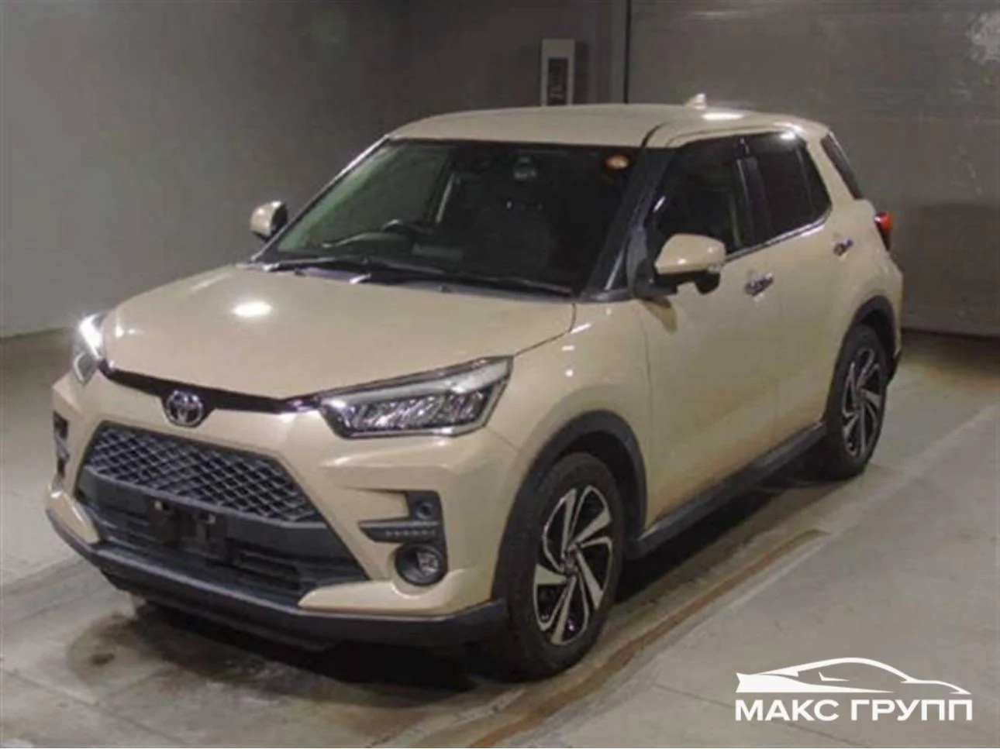

Японские автомобильные аукционы проходят как закрытые торги: ставки на них делают только аккредитованные участники. Поэтому частный покупатель из России работает через компанию с доступом к торгам. Она отбирает лоты, переводит аукционные листы, делает ставку в согласованных пределах, оплачивает автомобиль и отправляет его в порт. Ниже рассказываем, как это устроено по шагам и сколько стоит путь от ставки до Владивостока. Общий порядок работы описан на странице [«Как заказать авто»](/kak-zakazat/).

:::note Тарифы и сроки в статье даны как рыночные ориентиры по открытым прайсам перевозчиков и брокеров на октябрь 2026 года. Рубли посчитаны по курсу ЦБ на 13 октября 2026 года: 53,08 ₽ за 100 иен.
:::

## Этапы: от заявки до судна

1. Запрос. Вы называете модель, годы выпуска, предельный пробег и бюджет под ключ. От бюджета отнимают доставку, таможенные платежи и оформление: так получается предельная цена лота в иенах.
2. Отбор лотов. Менеджер присылает подходящие автомобили с переведенными аукционными листами и объясняет каждую отметку.
3. Ставка. По каждому лоту согласуется верхний предел. Если торги уходят выше, автомобиль достается другому участнику, а ставка переносится на следующий лот.
4. Оплата. После выигрыша оплачиваются лот и расходы в Японии. В «Макс Групп» платежи за рубеж проводит [платежный агент](/uslugi/platezhnyj-agent/) с полным комплектом документов.
5. Доставка в порт. Автомобиль забирают с аукциона, оформляют экспортные документы и ставят в очередь на судно.
6. Море. Сам морской переход до Владивостока занимает 3-4 дня, остальное время уходит на ожидание судна и погрузку.

Рыночный ориентир по прайсам перевозчиков: 4-6 недель от покупки до Владивостока. По отзывам клиентов «Макс Групп» бывает быстрее, 2-3 недели после покупки на аукционе: в одном из отзывов автомобиль купили в первые два дня поиска, и через две недели он уже стоял в порту.

## Какие автомобили можно купить для ввоза в Россию

Привезти из Японии можно автомобиль любого года и типа. Итоговая цена зависит от пошлины и утильсбора.

Выгоднее всего автомобили до 160 л.с. под льготный утильсбор: компактные хэтчбеки, кроссоверы, минивэны и кей-кары. Их собрали в подборке [авто из Японии до 160 л.с.](/avto-iz-yaponii/do-160-ls/)

Праворульные легковые автомобили в России можно ввозить и регистрировать: подробности в статье [о правом руле в России](/blog/pravyj-rul-v-rossii/). По данным таможенных брокеров, электронный паспорт сейчас получают бензиновые автомобили 2007 года выпуска и новее, дизельные 2008 года и новее.

## Аукционный лист: оценки и пометки

Аукционный лист заполняет инспектор аукциона до торгов. В нем общая оценка, оценка салона, пробег, комплектация, схема кузова с дефектами и комментарии. Начинают всегда с общей оценки.

| Оценка | Что означает |
|---|---|
| S | Почти новый автомобиль: обычно до 1 000 км и менее года с регистрации |
| 6 и 5 | Очень свежее или отличное состояние, небольшой пробег |
| 4.5 | Очень хорошее состояние, возможны единичные мелкие следы эксплуатации |
| 4 | Хорошее состояние, допустимы небольшие царапины и вмятины |
| 3.5 | Среднее состояние: заметные дефекты, иногда одна-две замененные кузовные детали |
| 3 | Удовлетворительное состояние: кузовные дефекты есть, но обычно ремонтопригодные |
| R, RA, RB | Ремонт после ДТП: RA обычно более легкий, RB означает серьезный ремонт кузова |
| *** | Продается как есть, часто аварийный или проблемный автомобиль |

Что стоит за каждой оценкой и какие лоты брать, разбираем в статье [об оценках аукционного листа](/blog/ocenki-aukcionnogo-lista/).

Салон оценивают отдельно буквой от A (отличный) до E (нужен ремонт и глубокая химчистка). На схеме кузова буква показывает тип дефекта, а цифра от 1 до 3 указывает его размер:

- A означает царапину, U вмятину, B вмятину с царапиной;
- W означает следы ремонта или покраски;
- S и C означают ржавчину и коррозию;
- X ставят, если элемент требует замены, XX, если он уже заменен.

Три листа из наших кейсов показывают, как это читается на практике. Toyota Yaris Cross X 4WD 2021 года: оценка 4, пробег 37 000 км, спокойный вариант без сюрпризов. Toyota Yaris Cross Z 4WD 2021 года: общая оценка 3.5, кузов A, салон C, пробег 47 000 км. У машины аккуратный кузов, но салону нужна химчистка. Toyota Raize Z 2021 года: оценка RA при пробеге 120 000 км. Это автомобиль после легкого ремонта, его берут осознанно и дешевле.

Аукционный лист помогает быстро оценить риски, но не заменяет проверку. Инспектор не всегда подробно разбирает двигатель и ходовую, поэтому комментарии читают так же внимательно, как оценку. Полная расшифровка букв, сокращений и японских пометок есть в справочнике [«Как читать аукционный лист»](/aukcionnyj-list/).

## Сколько стоит путь из Японии до Владивостока

Перевозчики считают расходы единым тарифом C&F. В него входят аукционный сбор с налогами, склад и экспортное оформление в Японии, погрузка и фрахт до Владивостока. Тариф зависит от цены лота.

| Цена лота | Тариф C&F | В рублях по курсу ЦБ |
|---|---|---|
| до 300 000 ¥ | 145 000 ¥ | около 77 000 ₽ |
| до 1 000 000 ¥ | 165 000 ¥ | около 87 600 ₽ |
| до 1 500 000 ¥ | 185 000 ¥ | около 98 200 ₽ |
| до 2 000 000 ¥ | 205 000 ¥ | около 108 800 ₽ |
| до 2 500 000 ¥ | 225 000 ¥ | около 119 400 ₽ |
| до 3 000 000 ¥ | 245 000 ¥ | около 130 000 ₽ |
| до 3 500 000 ¥ | 265 000 ¥ | около 140 700 ₽ |

Для лотов дороже 3,5 млн ¥ к тарифу добавляют примерно 25 000 ¥ за каждые 500 000 ¥ цены. Сам аукционный сбор внутри тарифа составляет от 5 до 21 тыс. ¥ в зависимости от площадки. Покупка по фиксированной цене или через переговоры после торгов обходится еще примерно в 15 000 ¥.

Два уточнения. Это рыночный ориентир, а не тариф «Макс Групп»: точные суммы менеджер считает под конкретный лот. И платеж в Японию идет не по курсу ЦБ, а по курсу перевода: по рыночным наблюдениям, для иены он выше курса ЦБ примерно на 3-8%. Это тоже ориентир, а не тариф компании.

## Пример сметы: Honda Fit за 1,1 млн иен

Honda Fit 1.3 2022 года на 98 л.с. можно назвать типичным заказом: мощность до 160 л.с., возраст от 3 до 5 лет.

| Статья | Сумма |
|---|---|
| Лот и расходы в Японии с фрахтом: 1 100 000 и 135 000 ¥ по курсу ЦБ | 655 506 ₽ |
| Таможенные платежи: пошлина, сбор, утильсбор | 220 660 ₽ |
| Оформление во Владивостоке и локальная логистика | 75 000 ₽ |
| Комиссия | 50 000 ₽ |
| **Под ключ во Владивостоке** | **1 001 166 ₽** |

Смета собрана так же, как расчеты в карточках каталога и в калькуляторе: лот и 135 000 ¥ расходов по Японии пересчитаны по курсу ЦБ, оформление и комиссия взяты как в карточках. По рыночному тарифу C&F из таблицы выше и с курсом перевода тот же автомобиль выйдет примерно на 70 тыс. ₽ дороже.

Таможенные платежи здесь: 210 536 ₽ пошлины по ставке 1,7 евро за кубик, 4 924 ₽ сбора и 5 200 ₽ льготного утильсбора. Как они считаются, разбираем в статье [о растаможке](/blog/rastamozhka-avto-2026/). Еще три сметы по строкам есть в статье [о стоимости авто из Японии](/blog/skolko-stoit-privezti-avto-iz-yaponii/). Свой вариант можно посчитать в [калькуляторе](/kalkulyator/).

## Что происходит после прихода судна

Во Владивостоке автомобиль выгружают на склад временного хранения. Дальше идут таможенная декларация, испытательная лаборатория, свидетельство о безопасности конструкции (СБКТС) и электронный паспорт (ЭПТС). Выпуск таможней занимает 2-5 дней, оформление СБКТС и ЭПТС еще 1-5 дней. В сумме от прихода судна до готовых документов проходит 7-14 дней. Что это за документы, объясняем в статье [о СБКТС и ЭПТС](/blog/sbkts-i-epts-chto-eto/).

Рыночная стоимость этого этапа 60-95 тыс. ₽: склад и брокер, лаборатория, СБКТС и ЭПТС. «Макс Групп» берет [таможенное оформление](/uslugi/tamozhennoe-oformlenie/) на себя: расчет пошлин и подготовку документов. После этого автомобиль можно забрать во Владивостоке или отправить в свой город. Способы и цены сравниваем в статье [о доставке по России](/blog/dostavka-avto-iz-vladivostoka/).

## Частые вопросы об аукционах Японии

### Можно ли участвовать в торгах самостоятельно?

Нет. Японские аукционы работают только с аккредитованными участниками. Частный покупатель делает ставки через компанию, у которой есть доступ к торгам: подробнее об этом на странице [«Аукционы Японии онлайн»](/uslugi/aukciony-yaponii/).

### Что будет, если ставка не сыграла?

Автомобиль уходит участнику, который предложил больше. Менеджер подбирает следующие лоты и ставит снова. Предел ставки вы определяете сами до торгов.

### Какую оценку выбирать?

Оценки 4 и 4.5 считаются нормальным выбором для автомобиля в хорошем состоянии. Оценка 3.5 требует внимательного разбора листа. Автомобили с R и RA стоят дешевле, но перед ставкой нужно понять, что именно ремонтировали.

### Сколько ждать автомобиль из Японии?

Рыночный ориентир 4-6 недель от покупки до Владивостока, а по отзывам наших клиентов 2-3 недели после покупки на аукционе. Еще 7-14 дней уходит на таможню и документы.
