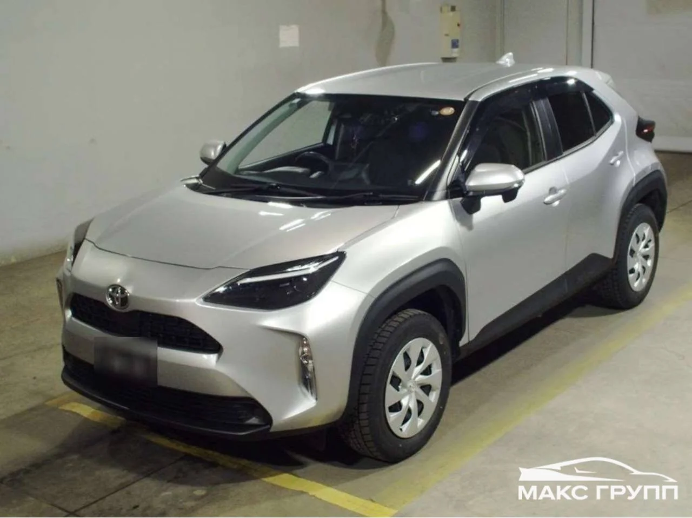

Короткий ответ. Япония — это праворульные автомобили с двигателем до 1,9 л и аукционным листом, где состояние описано до покупки. Корея — левый руль, бензин и дизель до 2,0 л. Китай — новые модели, электромобили и гибриды без экспортных ограничений. Таможенные правила в России одинаковы для всех трёх стран, поэтому выбор определяют руль, тип двигателя и то, что страна разрешает вывозить.

:::note Ограничения, расходы и сроки приведены на октябрь 2026 года по открытым прайсам перевозчиков и брокеров. Суммы в рублях посчитаны по курсу ЦБ на 13 октября 2026 года и носят ориентировочный характер.
:::

## Сравнение трёх рынков

| Параметр | Япония | Корея | Китай |
|---|---|---|---|
| Руль | Правый | Левый | Левый |
| Где покупают | Аукционы | Площадка Encar и дилерские стоянки | Дилеры и площадки подержанных авто |
| Что нельзя вывозить в Россию | Двигатели свыше 1,9 л, гибриды, электромобили | Двигатели свыше 2,0 л, автомобили дороже 50 000 $ | Ограничений по объёму и типу двигателя не выявлено |
| Расходы до российской границы | 145–265 тыс. ¥, это 77–141 тыс. ₽ | Около 2 млн вон, это 125 тыс. ₽ | Около 16,5 тыс. юаней, это 207 тыс. ₽ |
| Срок до Владивостока | 4–6 недель от покупки | 3–4 недели от покупки | 3–4 недели до Уссурийска и около недели на оформление |
| Оформление после прибытия | Около 80 тыс. ₽ | Около 83 тыс. ₽ | Около 90 тыс. ₽ |

Сроки в таблице — по прайсам перевозчиков. На практике бывает быстрее: по отзывам клиентов «Макс Групп», автомобили с японских аукционов оказывались в порту Владивостока через две-три недели после покупки. Срок зависит от порта отправления и расписания судов.

## Япония: аукционный лист и правый руль

Главное преимущество японского рынка — аукционы. У каждого лота есть аукционный лист: общая оценка состояния, оценка салона, пробег и схема кузова с отмеченными дефектами. Вы видите состояние машины до ставки, а не после покупки. Что стоит за оценками 4, 4.5 и R, разбираем в статье [об оценках аукционного листа](/blog/ocenki-aukcionnogo-lista/). Как читать оценки и пометки, рассказываем в справочнике [«Как читать аукционный лист»](/aukcionnyj-list/), а как проходят торги — в статье [о покупке на аукционе Японии](/blog/kak-kupit-avto-na-aukcione-yaponii/).

Что нужно учитывать:

- С 9 августа 2023 года Япония запрещает экспорт в Россию автомобилей с двигателем больше 1900 см³, гибридов и электромобилей. Свободно едут бензиновые и дизельные машины до 1,9 л и кей-кары.
- Запрещённые позиции на рынке возят через третьи страны. Это дольше и дороже, расчёт всегда индивидуальный: подробности — в статье [о «санкционных» авто](/blog/sankcionnye-avto-iz-yaponii-i-korei/).
- Праворульные легковые автомобили в России можно ввозить и ставить на учёт. Запрет касается только автобусов: о регистрации и страховке — в статье [о правом руле](/blog/pravyj-rul-v-rossii/).
- Расходы в Японии и фрахт перевозчики считают единым тарифом, который зависит от цены лота: от 145 000 ¥ за недорогую машину до 265 000 ¥ за лот ценой до 3,5 млн ¥.

Пример из наших кейсов: Toyota Yaris Cross X 4WD 2021 года с аукционной оценкой 4 и пробегом 37 000 км — 1 505 000 ₽ с таможенным оформлением, СБКТС и ЭПТС. Автомобиль купили на аукционе для клиента из Сургута.

Другие машины — в разделе [«Привезённые авто»](/privezennye-avto/), актуальные лоты — в каталоге [авто из Японии](/avto-iz-yaponii/).

## Корея: левый руль и понятная история

Корейские автомобили покупают на площадке Encar и на дилерских стоянках. Перед покупкой проверяют историю машины, страховые случаи и состояние по отчётам площадки и результатам осмотра.

Что нужно учитывать:

- С февраля 2024 года Корея запрещает экспорт в Россию автомобилей с двигателем больше 2000 см³, новых и подержанных. С апреля 2023-го под запретом машины дороже 50 000 $ — по текущему курсу это около 4,2 млн ₽.
- Автомобили под ограничениями на рынке возят через третьи страны. По открытому прайсу одного из импортёров надбавка за такой маршрут — порядка 1,5 млн вон. Риск таких схем вырос: по данным отраслевых источников, в сентябре 2026 года таможня Инчхона задержала экспортёров, которые вывезли в Россию и Беларусь более тысячи машин с двигателями больше 2 л.
- Типовые расходы в Корее: осмотр 100–250 тыс. вон, экспортные документы и комиссия агента около 750 тыс. вон, доставка до порта 150–250 тыс. вон, фрахт до Владивостока около 1 млн вон за седан или кроссовер и 1,25 млн вон за минивэн.

В итоге из Кореи без осложнений едут бензиновые и дизельные автомобили до 2,0 л: седаны и кроссоверы Hyundai и Kia, а также европейские марки с корейского рынка. Смотрите каталог [авто из Кореи](/avto-iz-korei/), а порядок покупки и проверки — в статье [об автомобилях из Кореи](/blog/kak-kupit-avto-iz-korei/).

## Китай: новые модели без экспортных ограничений

Ограничений на вывоз автомобилей в Россию по объёму или типу двигателя со стороны Китая на октябрь 2026 года не выявлено. Отсюда везут то, что закрыто в Японии и Корее: электромобили, гибриды, машины с двигателями больше 2 л, а также новые автомобили без пробега.

Что нужно учитывать:

- Главный ограничитель — российский утильсбор. Автомобиль мощнее 160 л.с. или электромобиль с 30-минутной мощностью выше 80 л.с. идёт по полной шкале, а это, как правило, от 900 тыс. ₽.
- Основной маршрут для Приморья сухопутный: автовозом до Суйфэньхэ, таможня в Уссурийске, затем перегон во Владивосток. По прайсам перевозчиков — 3–4 недели после оплаты до Уссурийска и около недели на оформление.
- Осмотр, экспертиза, экспортные документы, комиссия китайского партнёра и доставка до Уссурийска обходятся примерно в 16,5 тыс. юаней одной суммой. Рыночный диапазон — 12–22 тыс. юаней.
- Ввоз через Казахстан или Киргизию экономически невыгоден: льготный утильсбор для таких машин доступен только через 12 месяцев после выпуска в ЕАЭС.

Примеры из наших кейсов: Audi A3L 2023 года из Китая — 2 050 000 ₽ до Владивостока, электрический Nissan Ariya 2022 года — 2 600 000 ₽. Актуальные предложения — в каталоге [авто из Китая](/avto-iz-kitaya/), расходы и расчёт для электромобилей — в статье [об автомобилях из Китая](/blog/kak-privezti-avto-iz-kitaya/).

## Таможня: правила одни для всех

Страна покупки не влияет на таможенные платежи в России. Их определяют четыре параметра автомобиля:

- возраст — дешевле всего пошлина у [проходных машин от 3 до 5 лет](/blog/prohodnye-avto-3-5-let/);
- объём двигателя — от него зависит ставка пошлины за кубический сантиметр;
- мощность — до 160 л.с. действует [льготный утильсбор](/blog/utilsbor-2026-160-ls/);
- тип силовой установки — электромобили платят пошлину, акциз и НДС вместо единой ставки.

Полный разбор платежей с примерами по всем трём странам — в статье [о растаможке в 2026 году](/blog/rastamozhka-avto-2026/).

## Кому какая страна подходит

| Задача | Куда смотреть |
|---|---|
| Недорогой автомобиль с подтверждённым состоянием, правый руль не смущает | Япония |
| Компактный полноприводный автомобиль или минивэн до 1,9 л | Япония |
| Левый руль, бензин или дизель до 2,0 л, возраст 3–5 лет | Корея |
| Новый автомобиль или модель, которой нет в Японии и Корее | Китай |
| Электромобиль или гибрид | Китай, с проверкой мощности до покупки |
| Автомобиль мощнее 160 л.с. | Любая страна, но с утильсбором от 900 тыс. ₽ |

Если подходят две страны сразу, мы считаем один и тот же класс автомобиля из обеих и сравниваем итог под ключ. Начать можно с [калькулятора](/kalkulyator/) или с заявки менеджеру.

## Частые вопросы о выборе страны

### Можно ли привезти гибрид из Японии?

Напрямую — нет: экспорт гибридов из Японии в Россию запрещён с 9 августа 2023 года. «Мягкие» гибриды на практике возят, но это нужно уточнять у экспортёра по конкретной модели. Остальные идут через третьи страны, что дольше и дороже.

### Правый руль в России не запрещён?

На октябрь 2026 года праворульные легковые автомобили можно ввозить и регистрировать. Ограничение действует только для автобусов.

### Из какой страны автомобиль приходит быстрее?

По прайсам перевозчиков сроки близкие: 3–4 недели из Кореи, 4–6 недель из Японии, из Китая — 3–4 недели до Уссурийска и около недели на оформление. По отзывам наших клиентов, японские автомобили приходили в порт через 2–3 недели после покупки на аукционе.

### Где дешевле доставка до России?

По рыночным прайсам дешевле всего логистика из Японии — от 77 тыс. ₽ за недорогой лот. Из Кореи выходит около 125 тыс. ₽, из Китая — около 207 тыс. ₽ с доставкой до Уссурийска.
