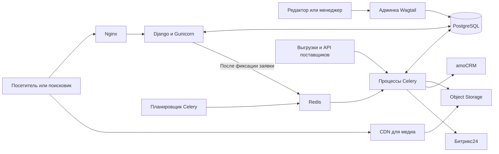

# Итоговый стек Max Group

Рабочий стек Max Group — **Python 3.13, Django 5.2 LTS, Wagtail 7.4 LTS и PostgreSQL 17**. Один Django-проект обслуживает сайт, каталог, редакторскую панель и формы. Точные версии Python-пакетов фиксируются в `uv.lock`. [Зависимости](../pyproject.toml) · [Совместимость Wagtail](https://docs.wagtail.org/en/v7.4/releases/upgrading.html#compatible-django-python-versions)

**Локальная версия запускается командой `make up`.** Nginx отдаёт файлы и передаёт запросы в Gunicorn. Django собирает HTML на сервере. Первоначальные макеты, данные и квизы поступают из существующих исходников на этапе сборки образа. Новые редакторские страницы создаются в Wagtail. [Сайт](http://localhost:8000/) · [Админка](http://localhost:8000/admin/) · [Порядок запуска](operations.md)

## Из чего состоит сайт

| Область | Технологии и назначение |
|---|---|
| Страницы и админка | Wagtail поверх Django. Разработчик определяет шаблоны и доступные блоки. Редактор меняет заголовки, тексты, кнопки, фото, порядок блоков и SEO-поля, смотрит черновик и публикует. Меню, контакты, шапка и подвал используют общие настройки. Роли ограничивают доступ к публикации и журналу заявок. [Блоки Wagtail](https://docs.wagtail.org/en/v7.4/topics/streamfield.html) · [Настройки сайта](https://docs.wagtail.org/en/v7.4/reference/contrib/settings.html) |
| Публичная часть | Django Templates отдают полный HTML. Используем CSS-токены и вёрстку Max Group. Обычный JavaScript подключаем для фильтров, калькулятора, квизов и галерей. Запросы обслуживают Nginx и Gunicorn. [Django и Gunicorn](https://docs.djangoproject.com/en/5.2/howto/deployment/wsgi/gunicorn/) |
| Каталог и данные | PostgreSQL хранит марки, модели, лоты, цены, источники, связи с медиа и редакторские правки. Структурированные карточки доступны в Wagtail через представления Django-моделей. Аукционные лоты — записи каталога. Страницы стран, моделей, тематические подборки, кейсы и статьи получают собственный редакторский контент. |
| Фоновая работа | Celery и Redis как брокер задач. Планировщик Celery Beat запускает импорт и проверяет ожидающие доставки заявок. Короткие задачи CRM получают свою очередь и отдельный процесс. Обработка фотографий и видео может масштабироваться самостоятельно. [Celery с Redis](https://docs.celeryq.dev/en/stable/getting-started/backends-and-brokers/redis.html) |
| Фото и видео | Ресурсы существующих страниц раздаёт Nginx. Для новых загрузок Wagtail использует локальный том, изображения и их версии создаёт Pillow. Видеоблок принимает файл и постер. Для рабочего домена предусмотрены S3-совместимое хранилище и CDN. Длинные обзоры с адаптивным HLS требуют подключения транскодирования. [Настройки хранилища](../backend/settings.py) · [Object Storage и CDN](https://yandex.cloud/ru/docs/cdn/quickstart/bucket) |
| Инфраструктура и поддержка | Целевая площадка — Yandex Cloud. Linux, Docker Compose, GitHub Actions, управляемый PostgreSQL, Cloud Logging для журналов и Cloud Monitoring для метрик и оповещений. Стенд и рабочая среда используют один образ приложения, отдельные БД, очереди и реквизиты интеграций. [Cloud Logging](https://yandex.cloud/ru/docs/logging/quickstart) · [Оповещения Monitoring](https://yandex.cloud/ru/docs/monitoring/concepts/alerting) |

## Как движутся данные

**Публикация.** Редактор сохраняет черновик, проверяет предпросмотр и публикует страницу. Веб-процесс читает опубликованную редакцию. Приложение кеширует исходный макет до внесения правок в конкретный ответ. CSRF-токен и идентификатор отправки формы создаются для запроса. Redis для Wagtail и Redis для очередей работают отдельно.

**Импорт автомобилей.** На старте лот можно завести вручную или загрузить из CSV. Адаптер каждого поставщика переводит данные API в ту же модель. Ключ `источник + внешний ID` связывает обновление с существующей машиной. Цены, наличие и время последнего подтверждения храним отдельно от редакторских заголовков, текста и выбранных фото. Ручная поправка имеет явный приоритет и может быть снята редактором. Публикуем партии после проверки полей, снятие лотов по отсутствию допускаем после успешной полной выгрузки согласно правилам поставщика. При частичном сбое доступна последняя успешная версия.

**Заявки.** Формы, квизы и калькулятор используют общий обработчик. Заявка и записи доставки для выбранных в окружении CRM сохраняются в одной транзакции PostgreSQL. После фиксации посетитель получает подтверждение. Менеджер видит заявку, её время, статус каждой CRM и внешний ID в Wagtail. [Обработчик форм](../backend/leads/views.py)

Celery отправляет заявки через API amoCRM и Битрикс24 при включённой доставке. Пара `ID заявки + CRM` уникальна. Воркер сверяет внешний UUID перед созданием. После неопределённого результата автоматически повторяется только сверка, затем запись доступна для ручного разбора. Для временных ошибок применяются паузы между попытками. Настройки конкретных аккаунтов проверяются на стенде. [Воркер CRM](../backend/leads/tasks.py) · [Настройка интеграций](operations.md)

## SEO и рост каталога

- Сохраняем действующие URL стран, марок, моделей, кейсов и статей. Цену, характеристики, H1 и навигационные ссылки отдаём в исходном HTML. Для реально перенесённой страницы настраиваем 301 на её прямую замену. [Google о рендеринге](https://developers.google.com/search/docs/crawling-indexing/javascript/javascript-seo-basics?hl=ru) · [Яндекс о навигации](https://yandex.ru/support/webmaster/ru/recommendations/frequent-mistakes)
- Выборку фильтруем, сортируем и разбиваем на страницы в PostgreSQL. Для списка используем по 24 машины, отдельные URL, обычные ссылки и собственный canonical. Похожие авто выбираем по индексированным характеристикам. Сейчас демо передаёт в одном HTML все 72 лота, а для блока похожих перебирает каталог для каждой карточки. [Пагинация и загрузка результатов](https://developers.google.com/search/docs/specialty/ecommerce/pagination-and-incremental-page-loading?hl=ru)
- Для востребованных сочетаний фильтров создаём содержательные посадочные. В sitemap включаем канонические страницы, открытые для поиска. Перед переездом сверяем правила для временных лотов с владельцем каталога. Проверяем статусы HTTP, robots, canonical, JSON-LD и карту перенаправлений по реестру старых URL. Доступность индексации отслеживаем через Яндекс Вебмастер и Google Search Console.
- Проверяем главную, каталог и карточку на мобильной сети с реальными фото и видео. Ориентиры для 75-го процентиля визитов — LCP до 2,5 с, INP до 200 мс и CLS до 0,1. Мощность ВМ и число процессов выбираем по пиковым посещениям, объёму и частоте импорта, просмотрам видео и допустимому простою. [Core Web Vitals](https://web.dev/articles/vitals?hl=ru)

## Граница локального выпуска

`make test` проверяет сохранность черновика и публикации при синхронизации, выдачу и фильтрацию лотов, импорт, обработку заявок и повторную сверку доставки. `make check-urls` проверяет все адреса выпуска. Для запуска на рабочем домене остаются тестовые воронки реальных CRM, облачное хранилище и CDN, мониторинг, восстановление копии, замеры скорости и нагрузки на выбранной инфраструктуре. [Инструкция сопровождения](operations.md)
