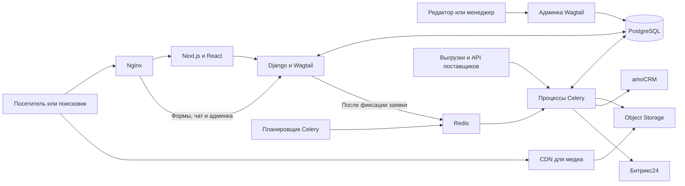

# Итоговый стек Max Group

Согласованная архитектура Max Group — **Next.js 16, React 19 и TypeScript, сервер на Node.js 24, база PostgreSQL 17 и собственная админка**. Next.js выдаёт готовый HTML для каталога, карточек и посадочных страниц. Размещение самостоятельное, в Docker за Nginx. [Правило проекта](../AGENTS.md) · [Самостоятельное размещение Next.js](https://nextjs.org/docs/app/guides/self-hosting)

| Часть целевой системы | Что она делает |
|---|---|
| Собственная админка на Next.js | Редактор меняет тексты, SEO-поля и медиа, просматривает черновик и публикует страницу. Менеджер видит заявки и состояние доставки по своим правам. |
| Бэкенд на Node.js и PostgreSQL | Сервер читает каталог и принимает формы. Хранит опубликованные версии и черновики, цены, редакторские правки и журнал заявок. Запросы каталога используют индексы для рабочих фильтров и сортировок. |
| Фоновые процессы на Node.js | Импортируют каталог из API поставщиков по идентификаторам источника. После сохранения заявки отправляют её в подключённую CRM клиента, учитывают повторные попытки и сохраняют результат. Доступы к amoCRM и Битрикс24 хранятся на сервере. |

## Действующий локальный выпуск

Публичный Next.js и PostgreSQL уже работают. Сегодня маршруты админки и API обслуживает Django 5.2 LTS с Wagtail 7.4 LTS на Python 3.13, фоновые задачи выполняет Celery. Собственная админка и перенос действующих функций на Node.js запланированы отдельно. При переносе проверяем историю редакций и черновики, права, адреса и медиа, редакторские изменения после повторного импорта, заявки и статусы их доставки. [Публичное приложение](../frontend/package.json) · [Действующий бэкенд](../pyproject.toml)

Локальный выпуск запускается командой `make up`. Публичные URL проходят через Nginx и Next.js. Админка и HTTP API доступны на том же домене. [Сайт](http://localhost:8000/) · [Админка](http://localhost:8000/admin/) · [Порядок запуска](operations.md)

| Область | Технологии и назначение |
|---|---|
| Страницы и админка | Wagtail поверх Django. Разработчик определяет шаблоны и доступные блоки. Редактор меняет заголовки, тексты, кнопки, фото, порядок блоков и SEO-поля, смотрит черновик и публикует. Меню, контакты, шапка и подвал используют общие настройки. Роли ограничивают доступ к публикации и журналу заявок. [Блоки Wagtail](https://docs.wagtail.org/en/v7.4/topics/streamfield.html) · [Настройки сайта](https://docs.wagtail.org/en/v7.4/reference/contrib/settings.html) |
| Публичная часть | Next.js Pages Router и серверный рендеринг. Компоненты React выводят метаданные, редакторские блоки, карточки новых лотов и пагинацию каталога. Согласованные макеты подключены как фрагменты HTML. На этих страницах интерактив обеспечивают скрипты Max Group. [SSR в Next.js](https://nextjs.org/docs/pages/building-your-application/rendering/server-side-rendering) · [Компоненты сайта](../frontend/components/) |
| Каталог и данные | PostgreSQL хранит марки, модели, лоты, цены, источники, связи с медиа и редакторские правки. Структурированные карточки доступны в Wagtail через представления Django-моделей. Аукционные лоты — записи каталога. Страницы стран, моделей, тематические подборки, кейсы и статьи получают собственный редакторский контент. |
| Фоновая работа | Celery и Redis как брокер задач. Планировщик Celery Beat запускает импорт и проверяет ожидающие доставки заявок. Короткие задачи CRM получают свою очередь и отдельный процесс. Обработка фотографий и видео может масштабироваться самостоятельно. [Celery с Redis](https://docs.celeryq.dev/en/stable/getting-started/backends-and-brokers/redis.html) |
| Фото и видео | Ресурсы существующих страниц раздаёт Nginx. Для новых загрузок Wagtail использует локальный том, изображения и их версии создаёт Pillow. Видеоблок принимает файл и постер. Для рабочего домена предусмотрены S3-совместимое хранилище и CDN. Длинные обзоры с адаптивным HLS требуют подключения транскодирования. [Настройки хранилища](../backend/settings.py) · [Object Storage и CDN](https://yandex.cloud/ru/docs/cdn/quickstart/bucket) |
| Инфраструктура и поддержка | Целевая площадка — Yandex Cloud. Linux, Docker Compose, GitHub Actions, управляемый PostgreSQL, Cloud Logging для журналов и Cloud Monitoring для метрик и оповещений. Для стенда и рабочей среды предусмотрены одинаковые образы Next.js, Django и Nginx, отдельные БД, очереди и реквизиты интеграций. [Cloud Logging](https://yandex.cloud/ru/docs/logging/quickstart) · [Оповещения Monitoring](https://yandex.cloud/ru/docs/monitoring/concepts/alerting) |

Чат работает с локальной моделью Qwen через llama.cpp во внутренней сети Compose. Django обрабатывает свободные вопросы. Модель уточняет параметры подбора, а тарифы, фактические ответы и ссылки берутся из выпуска сайта. Заявки на связь с менеджером идут через общий журнал и очередь Битрикс24. [Запуск чата](operations.md#чат-и-заявки-в-битрикс24)

## Как движутся данные в действующем выпуске

**Публикация.** Wagtail управляет правами, редакциями и выбором опубликованного содержимого. Next.js получает его по внутреннему запросу и выводит HTML, включая SEO-теги, JSON-LD и формы. Редакторские страницы и просмотр черновика используют одни React-компоненты. Сервер сохраняет статусы, перенаправления и CSRF-cookie бэкенда. HTML форм и черновиков имеет `Cache-Control: private, no-store`. CSS, изображения и видео раздаются отдельно.

**Импорт автомобилей.** На старте лот можно завести вручную или загрузить из CSV. Адаптер каждого поставщика переводит данные API в ту же модель. Ключ `источник + внешний ID` связывает обновление с существующей машиной. Цены, наличие и время последнего подтверждения храним отдельно от редакторских заголовков, текста и выбранных фото. Ручная поправка имеет явный приоритет и может быть снята редактором. Публикуем партии после проверки полей, снятие лотов по отсутствию допускаем после успешной полной выгрузки согласно правилам поставщика. При частичном сбое доступна последняя успешная версия.

**Заявки.** Формы, квизы и калькулятор используют общий обработчик. Заявка и записи доставки для выбранных в окружении CRM сохраняются в одной транзакции PostgreSQL. После фиксации посетитель получает подтверждение. Менеджер видит заявку, её время, статус каждой CRM и внешний ID в Wagtail. [Обработчик форм](../backend/leads/views.py)

Celery отправляет заявки через API amoCRM и Битрикс24 при включённой доставке. Пара `ID заявки + CRM` уникальна. Воркер сверяет внешний UUID перед созданием. После неопределённого результата автоматически повторяется только сверка, затем запись доступна для ручного разбора. Для временных ошибок применяются паузы между попытками. Настройки конкретных аккаунтов проверяются на стенде. [Воркер CRM](../backend/leads/tasks.py) · [Настройка интеграций](operations.md)

## SEO и рост каталога

- Сохраняем действующие URL стран, марок, моделей, кейсов и статей. Цену, характеристики, H1 и навигационные ссылки отдаём в исходном HTML. Для реально перенесённой страницы настраиваем 301 на её прямую замену. [Google о рендеринге](https://developers.google.com/search/docs/crawling-indexing/javascript/javascript-seo-basics?hl=ru) · [Яндекс о навигации](https://yandex.ru/support/webmaster/ru/recommendations/frequent-mistakes)
- Выборку фильтруем, сортируем и разбиваем на страницы в PostgreSQL. Для списка используем по 24 машины, отдельные URL, обычные ссылки и собственный canonical. Похожие авто выбираем по индексированным характеристикам. Сейчас демо передаёт в одном HTML все 72 лота, а для блока похожих перебирает каталог для каждой карточки. [Пагинация и загрузка результатов](https://developers.google.com/search/docs/specialty/ecommerce/pagination-and-incremental-page-loading?hl=ru)
- Для востребованных сочетаний фильтров создаём содержательные посадочные. В sitemap включаем канонические страницы, открытые для поиска. Перед переездом сверяем правила для временных лотов с владельцем каталога. Проверяем статусы HTTP, robots, canonical, JSON-LD и карту перенаправлений по реестру старых URL. Доступность индексации отслеживаем через Яндекс Вебмастер и Google Search Console.
- Проверяем главную, каталог и карточку на мобильной сети с реальными фото и видео. Ориентиры для 75-го процентиля визитов — LCP до 2,5 с, INP до 200 мс и CLS до 0,1. Мощность ВМ и число процессов выбираем по пиковым посещениям, объёму и частоте импорта, просмотрам видео и допустимому простою. [Core Web Vitals](https://web.dev/articles/vitals?hl=ru)

## Граница локального выпуска

`make test` проверяет Django на тестовой БД и публичный путь через Nginx и Next.js. `make check-urls` сверяет ожидаемый HTTP-статус и рендерер каждого адреса выпуска. Тестовые воронки рабочих CRM, облачные хранилище и CDN, мониторинг и замеры нагрузки относятся к вводу сайта на рабочем домене. [Инструкция сопровождения](operations.md)
